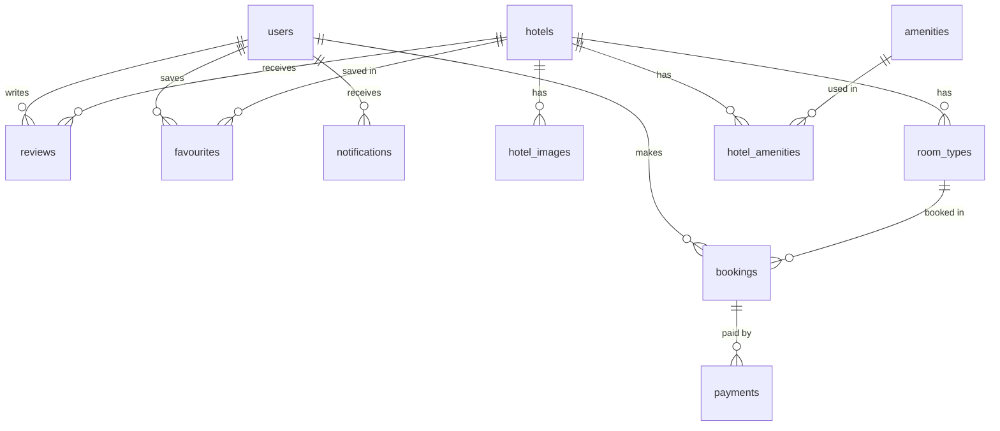

# Budgie Stays

Budgie Stays is a full-stack hotel booking app for budget-friendly stays across South Africa. Guests can search hotels, view photos, rooms and reviews, book a stay and pay online. Admins manage hotels, rooms, bookings and users from an admin panel.

**Live site:** [https://budgie-stays-hotel.onrender.com]
**API:** [https://budgie-stays-api.onrender.com]

---

## Features

### Guests
- Register and log in with email and password, or with Google (OAuth)
- Browse hotels and filter by location, price, star rating and guest rating
- Hotel page with photo gallery, map, rooms and prices, amenities, policies and reviews
- Share a hotel and save it to favourites
- Book a stay: choose a room, dates, number of rooms and guests
- Pay online with Paystack, or choose to pay at the hotel
- Profile page to edit details, view bookings and favourites
- Leave a review and rating after a completed stay
- Notifications for booking confirmations and updates

### Admins
- Dashboard with totals for hotels, users and bookings
- Add, edit, hide and delete hotels, including policies and check-in/check-out times
- Manage each hotel's rooms (type, capacity, price, number of rooms), photos and amenities
- View all bookings, filter by status and change a booking's status (confirm, complete or cancel)
- View users and block or unblock accounts

---

## Tech Stack

| Part | Tools |
|---|---|
| Frontend | React, TypeScript, Vite, Redux Toolkit, React Router, Axios, CSS Modules |
| Backend | Node.js, Express, TypeScript |
| Database | PostgreSQL |
| Authentication | JWT, bcrypt, Google OAuth |
| Payments | Paystack (test mode) |

---

## Project Structure

```
full-stack-hotel-app/
├── backend/
│   └── src/
│       ├── config/        # database connection and table setup
│       ├── controllers/   # handle requests and responses
│       ├── db/            # schema.sql
│       ├── middleware/    # protect and adminOnly
│       ├── models/        # TypeScript interfaces
│       ├── routes/        # API routes
│       ├── services/      # SQL queries
│       └── server.ts
└── frontend/
    └── src/
        ├── components/
        ├── pages/
        ├── redux/         # store and slices
        ├── types/
        └── utils/
```

The backend follows **routes → controllers → services**. Routes define the URLs, controllers check the request and send the response, and services run the SQL.

---

## Getting Started

### What you need
- Node.js
- PostgreSQL
- A Paystack account (test mode is free)
- A Google OAuth Client ID

### 1. Clone the project

```bash
git clone [your repository link]
cd full-stack-hotel-app
```

### 2. Backend

```bash
cd backend
npm install
```

Create a `.env` file in the `backend` folder:

```
PORT=3001
DB_USER=your_db_user
DB_HOST=localhost
DB_DATABASE=your_db_name
DB_PASSWORD=your_db_password
DB_PORT=5432
JWT_SECRET=your_secret
PAYSTACK_SECRET_KEY=sk_test_xxxxx
FRONTEND_URL=http://localhost:5173
GOOGLE_CLIENT_ID=your_google_client_id
```

Start the server:

```bash
npm run dev
```

The tables are created automatically from `schema.sql` when the server starts.

### 3. Frontend

```bash
cd frontend
npm install
```

Create a `.env` file in the `frontend` folder:

```
VITE_GOOGLE_CLIENT_ID=your_google_client_id
```

Start the app:

```bash
npm run dev
```

Open `http://localhost:5173`.

### 4. Make an admin user
Register an account in the app, then run this in PostgreSQL:

```sql
UPDATE users SET role = 'admin' WHERE email = 'your@email.com';
```

### Test payment
Use Paystack's test card on the payment page:
- Card number: `4084 0840 8408 4081`
- Expiry: any future date
- CVV: `408`

---

## Database

The database has 11 tables:

| Table | What it stores |
|---|---|
| `users` | Guests and admins |
| `hotels` | Hotel details, policies and check-in/out times |
| `hotel_images` | Hotel photos (one main photo per hotel) |
| `amenities` | List of facilities, e.g. Free Wi-Fi, Pool |
| `hotel_amenities` | Links hotels to their amenities |
| `room_types` | Rooms for each hotel, with capacity, price and number of rooms |
| `bookings` | Guest bookings |
| `payments` | Payments for bookings |
| `reviews` | Ratings and comments (one per guest per hotel) |
| `favourites` | Hotels a user has saved |
| `notifications` | Messages sent to users |



Some design choices:
- `hotel_amenities` and `favourites` are junction tables for many-to-many relationships.
- Each booking saves its own `price_per_night`, so later price changes don't affect old bookings.
- Room availability is worked out from `total_rooms` minus the rooms already booked for overlapping dates.
- A hotel with bookings can't be deleted. The admin hides it instead.

---

## API Endpoints

🔒 = must be logged in, 👑 = admin only

### Auth
| Method | Endpoint | Description |
|---|---|---|
| POST | `/api/auth/register` | Register |
| POST | `/api/auth/login` | Log in |
| POST | `/api/auth/google` | Log in with Google |
| PATCH | `/api/auth/me` 🔒 | Update my profile |

### Hotels
| Method | Endpoint | Description |
|---|---|---|
| GET | `/api/hotels` | List visible hotels |
| GET | `/api/hotels/:id` | Get one hotel |
| POST | `/api/hotels` 👑 | Add a hotel |
| PUT | `/api/hotels/:id` 👑 | Update a hotel |
| DELETE | `/api/hotels/:id` 👑 | Delete a hotel |

### Rooms, Photos and Amenities
| Method | Endpoint | Description |
|---|---|---|
| GET | `/api/hotels/:id/rooms` | A hotel's rooms |
| POST | `/api/hotels/:id/rooms` 👑 | Add a room |
| PUT | `/api/rooms/:id` 👑 | Update a room |
| DELETE | `/api/rooms/:id` 👑 | Delete a room |
| GET | `/api/hotels/:id/images` | A hotel's photos |
| POST | `/api/hotels/:id/images` 👑 | Add a photo |
| PUT | `/api/images/:id` 👑 | Update a photo / set as main |
| DELETE | `/api/images/:id` 👑 | Delete a photo |
| GET | `/api/amenities` | All amenities |
| POST | `/api/amenities` 👑 | Add an amenity |
| GET | `/api/hotels/:id/amenities` | A hotel's amenities |
| PUT | `/api/hotels/:id/amenities` 👑 | Set a hotel's amenities |

### Bookings and Payments
| Method | Endpoint | Description |
|---|---|---|
| POST | `/api/bookings` 🔒 | Make a booking |
| GET | `/api/bookings/my` 🔒 | My bookings |
| GET | `/api/bookings/:id` 🔒 | One booking (owner or admin) |
| PATCH | `/api/bookings/:id/cancel` 🔒 | Cancel my booking |
| GET | `/api/bookings` 👑 | All bookings |
| PATCH | `/api/bookings/:id/status` 👑 | Change a booking's status |
| POST | `/api/payments/initialize` 🔒 | Start a Paystack payment |
| GET | `/api/payments/verify/:reference` 🔒 | Check the payment and confirm the booking |

### Reviews, Favourites and Notifications
| Method | Endpoint | Description |
|---|---|---|
| GET | `/api/hotels/:id/reviews` | A hotel's reviews and average rating |
| POST | `/api/hotels/:id/reviews` 🔒 | Add a review (after a completed stay) |
| PUT | `/api/reviews/:id` 🔒 | Edit my review |
| DELETE | `/api/reviews/:id` 🔒 | Delete my review (or any, for admins) |
| GET | `/api/favourites` 🔒 | My favourites |
| POST | `/api/favourites/:hotelId` 🔒 | Save a hotel |
| DELETE | `/api/favourites/:hotelId` 🔒 | Remove a saved hotel |
| GET | `/api/notifications` 🔒 | My notifications |
| PATCH | `/api/notifications/:id/read` 🔒 | Mark one as read |
| PATCH | `/api/notifications/read-all` 🔒 | Mark all as read |

### Admin
| Method | Endpoint | Description |
|---|---|---|
| GET | `/api/admin/stats` 👑 | Dashboard totals |
| GET | `/api/admin/hotels` 👑 | All hotels, including hidden ones |
| GET | `/api/admin/users` 👑 | All users |
| PATCH | `/api/admin/users/:id/status` 👑 | Block or unblock a user |

---

## Security

- Passwords are hashed with bcrypt and never sent back from the API.
- Protected routes use JWT tokens. Admin routes also check the user's role.
- Blocked users can't log in or use protected routes.
- All SQL uses parameterised queries (`$1`, `$2`) to prevent SQL injection.
- Prices are worked out on the backend, never taken from the frontend.
- A booking is only confirmed after the backend checks the payment with Paystack.
- Card details are entered on Paystack's page and never reach this app.
- Secret keys are kept in `.env` files, which are not pushed to GitHub.

---

## Author

Neliswa
